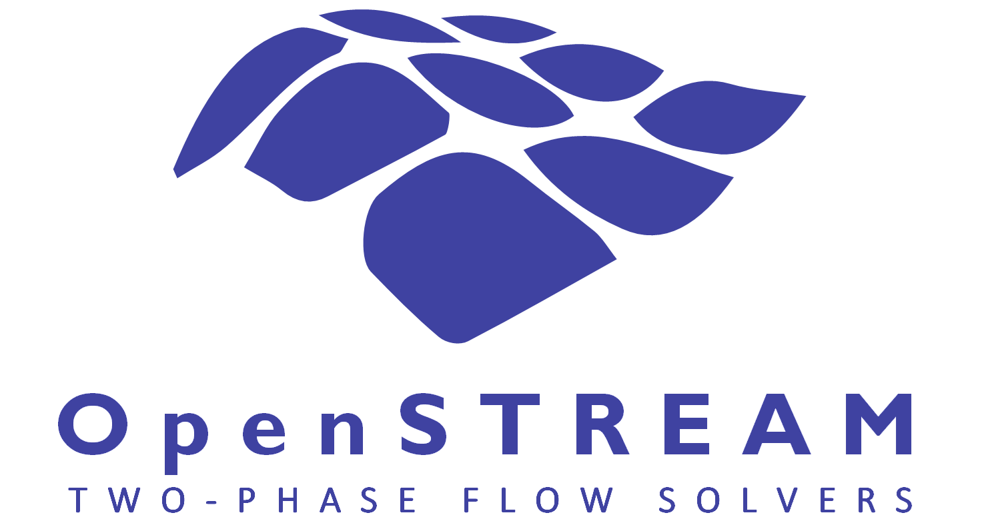

# OpenSTREAM_pyversion



This project translates [OpenSTREAM](https://github.com/OpenSTREAM-solvers/openstream) into native Python for local Windows execution. Normal operation uses **no MATLAB, MATLAB Engine or Octave**. The unchanged MATLAB source, documentation, examples, regression objects and CoolPropWrapper submodule are preserved in `upstream/` for comparison.

**This is a partial scientific port under verification, not a claim of complete numerical equivalence or experimental validation.** The documented mixture sample runs from the original inputs. Additional frameworks and closures have separate implementation and test statuses in [docs/FEATURE_MAP.md](docs/FEATURE_MAP.md). Read [docs/VERIFICATION.md](docs/VERIFICATION.md) before interpreting results, particularly transient energy balances and suspected upstream defects.

**All four steady baselines verified:** Mixture, TwoFluid, ThreeField and FourField pass their original W/U/H comparisons against recovered MATLAB archives at unchanged `rtol=1e-8`, `atol=0`, including initialization histories and mixture precursors. No MATLAB runtime was needed. Version 0.1.1 also corrects the source-specific MRM NaN/Inf fallback. Physical area inconsistencies are confirmed in the original archives; diagnostic differences and unknown producer metadata remain explicit in [docs/ALL_BASELINES_VERIFICATION.md](docs/ALL_BASELINES_VERIFICATION.md). This is selected-case agreement, not complete feature parity or experimental validation.

The [matched diagnostic replay](docs/MATCHED_DIAGNOSTIC_REPLAY.md) identifies and
corrects a FourField precursor-selection translation error. All four archived
baselines still pass. Sawai point nonconvergence remains; the 400-cell TwoFluid
case converges with a separately tested longer initialization budget. Equations
and tolerances are unchanged; fresh MATLAB comparison remains unavailable.

The [Sawai oscillation diagnostic](docs/SAWAI_OSCILLATION_DIAGNOSTIC.md) traces
the remaining 0.2 s/100-cell failure to a cycle dominated by signed deposition.
All 215 reference arrays are reproduced exactly. No additional translation
error was confirmed or numerical setting changed; the failed point criterion
and unresolved matched MATLAB comparison remain in the acceptance matrix.

The separate [Sawai numerical-control study](docs/SAWAI_CONTROL_STUDY.md)
completed all eight registered cases: six native convergence passes, but none
passes the fixed-scale common-state wave mass-defect screen. A higher point
iteration cap alone has negligible effect; lower-relaxation profiles remain
sensitive to the control setting. Equations, closures, tolerances and defaults
are unchanged. The supplemental screen is not an experimental or new closure
criterion, and no MATLAB-equivalence status is promoted.

## Hosted application

Open [openstream-py.vercel.app](https://openstream-py.vercel.app) and enter the
shared password supplied by the project owner. Select a model, edit inputs,
then choose **Check** and **Run**. Results provide interactive profiles and
authenticated ZIP downloads. Hosted calculations use the same native Python
worker, with a 40-minute job limit including setup and export.

All four hosted TUTORIAL1 workflows passed the retained archived-profile
comparisons. See [hosting instructions](docs/HOSTED_GUI.md) and the
[hosted verification report](docs/HOSTED_VERIFICATION.md) for the tested scope,
retained failures and scientific limitations.

## Install and run on Windows

Install 64-bit Python 3.12 and Git, then run in PowerShell:

```powershell
git clone --recurse-submodules https://github.com/romanwilliammorse/OpenSTREAM_pyversion.git
Set-Location OpenSTREAM_pyversion
py -3.12 -m venv .venv
.\.venv\Scripts\python.exe -m pip install -r requirements.lock -r requirements-gui.lock
.\.venv\Scripts\python.exe -m pip install --no-build-isolation -e '.[gui]'
.\.OpenSTREAM-GUI.cmd
```

Optional desktop shortcut: `.\tools\install_gui_shortcut.ps1`.
The GUI runs at `http://127.0.0.1:8765` and uses local assets throughout.
See [GUI usage](docs/GUI.md), [repository contents](docs/REPOSITORY_CONTENTS.md),
and the [remaining parity and validation work](docs/PARITY_COMPLETION.md).
The [acceptance matrix](docs/ACCEPTANCE_MATRIX.md) and
[prioritized work plan](docs/ACCEPTANCE_PLAN.md) track the missing and unverified
requirements separately from demonstrated results.

Physical-validation work uses the experimental datasets in
[OpenSTREAM-database](https://github.com/OpenSTREAM-solvers/openstream-database).
Archived MATLAB agreement and experimental validation are separate acceptance
tracks. The [native Bartolomey adapter and frozen pilot](docs/BARTOLOMEY.md)
provide the first measured-versus-predicted workflow; uncertainty-qualified
experimental validation remains incomplete. The database is pinned and preserved
as a separate Git submodule.

The [Le Corre NURETH-21 reconstruction](docs/LECORRE_REPRODUCTION.md) adds native
Wurtz and Sawai input adapters, frozen paper/companion variants, comparisons with
digitized published curves, and separate numerical-sensitivity studies.
All 69 planned runs completed: 63 met the native convergence checks.
Phase-volume residuals are informational for ThreeField and FourField, following
the original OpenSTREAM convergence logic. Original diagnostic assessments are
preserved separately; no physical-validation pass is inferred from this policy.
Original publication-time settings remain partly unresolved. Graphical agreement,
native convergence, physical consistency and experimental accuracy are reported
separately; no governing equation is adjusted to improve the comparison.
The [reconstruction report with figure plates](output/pdf/LeCorre_2025_Reports_03/LECORRE_REPRODUCTION.pdf)
contains the native Python counterparts to Figures 3, 4, 6 and 7. Figures 1 and
2 are model schematics; Figure 5 still lacks the original TRACE reference data.

## Existing local installation

Double-click **OpenSTREAM GUI** on the Desktop for the local browser interface.
Select one of the four steady baselines, inspect all 163 inputs alongside their
reference/default values, and click **Run**. Results include
interactive plots, baseline overlays, separate verification statuses, and
downloadable numerical files. See [docs/GUI.md](docs/GUI.md).

For a ready-to-use command window, double-click **OpenSTREAM Python** on the Desktop or `OpenSTREAM.cmd` in this folder. At Python's `>>>` prompt, enter `sample()`, `checks()`, or `guide()`. See [docs/GETTING_STARTED.md](docs/GETTING_STARTED.md) for plotting and animation commands. This launcher uses the same native solver and isolated environment as the CLI.

In PowerShell:

```powershell
Set-Location 'C:\Users\Roman\Documents\ChatGPT\OpenSTREAM'
.\.venv\Scripts\python.exe -m openstream sample --inputs upstream\inputs --output outputs\my-sample
.\.venv\Scripts\python.exe -m pytest -q
```

Use a **new output directory** for each run. Results are never overwritten. `outputs/release-02/MixtureSolver` contains the final saved sample; adjacent directories contain the other frameworks and their explicit failure diagnostics. Output includes `results.npz`, `initialization.npz`, unit-labelled CSVs, `metadata.json`, `convergence.csv` and `axial.png`. Initialization time is pseudo-time, not a physical transient.

The current isolated environment uses CPython 3.12.14 from the Codex-managed local runtime. Its base interpreter is recorded in `provenance/environment.json`. It is not the Windows Store `python.exe` alias. If that base interpreter is removed, recreate `.venv` with a standard 64-bit Python 3.12 installation.

## Recreate the environment

Choose a framework with `--framework mixture`, `twofluid`, `threefield` or `fourfield`.
For ThreeField and FourField, phase-volume closure is an informational diagnostic:
it does not cause a failure exit or change numerical convergence. The TwoFluid
area check remains active and can return exit code 3. Exit code 2 means numerical
nonconvergence; exit code 0 does not establish experimental validation. See the
[OpenSTREAM convergence and diagnostics review](docs/LECORRE_PHYSICAL_REVIEW.md).

Install 64-bit Python 3.12, then:

```powershell
git submodule update --init --recursive
py -3.12 -m venv .venv
.\.venv\Scripts\python.exe -m pip install -r requirements.lock
.\.venv\Scripts\python.exe -m pip install --no-build-isolation -e .
.\.venv\Scripts\python.exe -m pytest -q
```

The package is installable with `pip install .` or the built wheel in `dist/`. Unchanged example input files are bundled in the wheel, so installed operation does not require the source checkout. No network access is needed during calculations after installation; CoolProp may create its local interpolation-table cache on first use.

## Python API

```python
from openstream import InputSet, MixtureSolver

inputs = InputSet.official_sample()  # bundled original TUTORIAL1 input files
solver = MixtureSolver(inputs).solve()
if not solver.converged:
    raise RuntimeError(solver.STATE.name)
mixture = solver.mixture[0]
print(mixture.Z, mixture.H, mixture.VF())
solver.save('outputs/api-run')
```

Use `InputSet.from_files(model_file, model_id, options_file, options_id, geometry_file, geometry_id, bc_file)` for other original `.inp` files. Public model/option names retain upstream uppercase spelling. Change an input before constructing a solver; construction validates and copies it. Reusing a solved solver requires `initialize_solver()`.

```python
inputs.model.NNODES = 200
inputs.options.TSTEP = 0.05
```

Node indices are zero based. Mixture `W`, `P`, `H` arrays have shape `(nodes,)`; wall quantities have `(nodes,walls)`. Saved arrays add a leading time axis. Derived properties are methods, for example `mixture.U()` or `mixture.U(10)`. Physical quantities use SI units except `Geometry.ANGLE`, which is degrees from vertical, matching the equations and Geometry.m despite the original geom.inp's erroneous `[rad]` comment. Editing solved fields directly can invalidate caches.

See [docs/API.md](docs/API.md) for additional frameworks, physical transients and post-processing. Unsupported selections raise explicit errors; an unavailable model is never replaced by a different model.

Saved results also support axial profiles, time histories, space–time maps and GIF animations without re-running a solver. For example, `SavedResults('outputs/sample-final').axial('H')` returns a Matplotlib figure (`from openstream import SavedResults`). See [docs/PLOTTING.md](docs/PLOTTING.md) and `examples/plot_saved_results.py`. Initialization plots explicitly identify pseudo-time. Full MATLAB styling and diagnostic-selection parity remain incomplete.

## Reference comparisons and provenance

OpenSTREAM: `a614c7173822a93c1e64ac28d1541cbac028cbd8`. CoolPropWrapper: `a7c40902ff66faf6ed668986398bb1b9faa16e13`.

Upstream `.mat` fixtures contain opaque MATLAB objects. The native verification readers now recover all four preserved archives. Run `.\.venv\Scripts\python.exe tools\verify_all_baselines.py --output outputs\my-baseline-check` to recover, solve, compare and plot all four cases in a new directory. See [tools/REFERENCE_READER.md](tools/REFERENCE_READER.md) for the isolated reader dependencies. [tools/export_matlab_reference.m](tools/export_matlab_reference.m) remains available for a fresh run or export in a separately available MATLAB environment; it has not been executed. [docs/UPSTREAM_AUDIT.md](docs/UPSTREAM_AUDIT.md) records the earlier inspection and reference policy.

No reference files or regression tolerances were overwritten. Agreement with MATLAB and validation against experiments are separate tasks. The port preserves source equations, fixed-point algorithms, system-pressure property assumptions, limits and identified source quirks; documented issues are not silently repaired.

MIT license. Original OpenSTREAM and CoolPropWrapper notices are retained. See `LICENSE`, `upstream/LICENSE`, `upstream/+CoolPropWrapper/LICENSE`, and [docs/THIRD_PARTY.md](docs/THIRD_PARTY.md).
