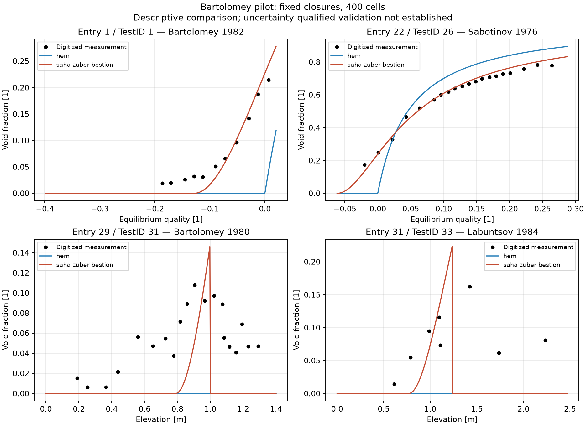

# Bartolomey pilot: executed evidence and remaining gates

Completed locally on 2026-11-14 (America/Chicago). The native adapter and
descriptive experimental-comparison workflow are operational. **The pilot does
not pass every numerical acceptance criterion and does not establish full
MATLAB parity or uncertainty-qualified experimental validation.**

## Scope fixed before calculation

Manifest [examples/bartolomey_pilot.json](../examples/bartolomey_pilot.json) was
committed as `4e76cc1b3d5751d4b2f02f7ff74c35124d31174c` before evaluating prediction
errors. Its canonical SHA-256 is
`c193f988b5313329bbeac7408a46f02a618fff6daaa583337b296721abab4b55`.
The database is pinned at `b48541e6438a92b4c0ddc83cf0ceda3f71a59b22` and preserves
all 34 source records. The selection rule takes the first row of each TestName
group: entries 1, 22, 29 and 31, corresponding to TestIDs 1, 26, 31 and 33.
Two rows use equilibrium quality and two use measured elevation.

The two presets are upstream default HEM and unchanged TUTORIAL2D
Saha–Zuber/Bestion. Other model coefficients retain source defaults, including
the source input writer's numeric round-trip. No coefficients were fitted.
Each case/model was run with 100, 200 and 400 cells, plus a tenfold tighter
iteration criterion and a 0.5 s rather than 1 s pseudo-time step at 200 cells:
40 runs total. Pseudo-time is initialization, not a physical transient.

## Execution and verification

| Evidence | Result | Limit |
|---|---:|---|
| Source XML records read and mapped to native inputs | 34/34 | Bartolomey only; other families/transient database schedules unsupported |
| New adapter/comparator/pilot-policy tests | 85/85 passed | Includes GUI-export and observed-quantity/unit regression tests; no MATLAB reference execution |
| Attempted runs completed | 40/40 | All attempts retained |
| Solver convergence | 40/40 passed | Frozen point and pseudo-time stopping criteria |
| Prescribed physical checks | 40/40 passed | Steady mass, transported enthalpy, source momentum residual, boundary conditions, phase area and bounds |
| Mesh/iteration/pseudo-time sensitivity | 29/32 passed | Three mesh criteria failed; no asymptotic-order or numerical-uncertainty claim |
| Unique digitized measurements | 59 | 118 paired values across two finest-mesh models, no exclusions |
| Independent saved-output arithmetic audit | 40 runs / 590 paired rows passed | Rechecks CSV errors/units and saved-array heating/enthalpy; repeated meshes are not independent experiments |
| Pilot runtime warnings | 0 | Separate existing FourField regression warnings are outside this campaign |
| Fresh MATLAB equivalence | Not run | No independent MATLAB results for these configurations |
| Uncertainty-qualified experimental acceptance | Not established | Digitization/input/coordinate propagation and calibration independence remain incomplete |

The physical-check scope retains OpenSTREAM's governing equations and
system-pressure property approximation. Energy is the source's transported
enthalpy equation, not a more general total-energy equation. Momentum checks
the final initialization discrete source equation; there is no independent
pressure-drop measurement in this pilot.

## Measured-versus-predicted results

Errors are **predicted minus measured** void fraction. A percentage point is
0.01 dimensionless void fraction; it is not relative percent error. These
400-cell results are descriptive, including cases that failed mesh screening.

| Entry / TestID | Model | Points | Bias [pp] | MAE [pp] | RMSE [pp] |
|---|---|---:|---:|---:|---:|
| 1 / 1 | HEM | 11 | -7.65585 | 7.65585 | 9.73944 |
| 1 / 1 | Saha–Zuber/Bestion | 11 | -0.86148 | 1.89512 | 2.08962 |
| 22 / 26 | HEM | 20 | 5.81143 | 9.97803 | 10.96340 |
| 22 / 26 | Saha–Zuber/Bestion | 20 | 0.98974 | 1.85300 | 2.16191 |
| 29 / 31 | HEM | 20 | -5.48128 | 5.48128 | 6.20564 |
| 29 / 31 | Saha–Zuber/Bestion | 20 | -4.54886 | 4.73581 | 5.32488 |
| 31 / 33 | HEM | 8 | -8.21891 | 8.21891 | 9.19130 |
| 31 / 33 | Saha–Zuber/Bestion | 8 | -4.01247 | 6.02192 | 7.50784 |

Saha–Zuber/Bestion reduces the descriptive error for these selected cases,
especially the quality-coordinate cases. This observation does not establish
model applicability across the dataset. The heated-to-adiabatic cases expose
an explicit capability limit: the algebraic Saha–Zuber model uses local heat
flux and cannot retain finite downstream condensation history after heating
stops; HEM predicts zero void while the equilibrium quality is subcooled.
The measurements retain downstream void. This disagreement alone is not
evidence of a Python translation defect. The separate calibrated MRM companion
is not reproduced or substituted in this campaign.

## Retained numerical failures

The frozen mesh screening threshold is a maximum change of **0.002** in
dimensionless void fraction at the same measured coordinates. The following
criteria failed; thresholds and outputs were not altered:

| Entry | Model | Mesh change | Maximum change [1] | Threshold [1] |
|---:|---|---|---:|---:|
| 22 | HEM | 100 → 200 | 0.0034520131 | 0.002 |
| 22 | HEM | 200 → 400 | 0.0043236369 | 0.002 |
| 29 | Saha–Zuber/Bestion | 200 → 400 | 0.0050731955 | 0.002 |

All 16 tighter-iteration and pseudo-time sensitivity checks passed their fixed
0.0002 threshold. Passing those checks does not resolve the mesh failures.
The comparison uses identical point populations and requires both runs to
converge; no measurement disappeared to make a sensitivity check pass.

The [saved-array diagnosis](../outputs/validation/bartolomey-pilot-01/mesh_diagnosis.json)
identifies the causes without replacing these failed criteria. For entry 22,
the worst observation has equilibrium quality 0.00052117; the 100/200-cell
interpolation intervals cross the slope change at zero quality. Direct HEM
evaluation there gives void fraction 0.0108295177, versus the saved interpolated
0.0185330178, 0.0150810047 and 0.0107573678 at 100/200/400 cells.
For entry 29, the discrete heated extent changes from 0.994 to 0.9975 m;
normalizing fixed total power changes heat flux and the algebraic prediction.
Only 0.00000109104 of the 0.00507319554 prediction change comes from interpolation.
Independent transcription of the algebraic closures reproduces the inspected
nodal arrays with the same BICUBIC&HEOS backend. This diagnoses numerical
sampling/heating representation, not a need to change the governing equations.

## Sources, uncertainty and next gates

The [source review](BARTOLOMEY_SOURCE_REVIEW.md) records NUREG/IA-0025's stated
absolute void-fraction error below 0.04 and its limited example input-error
bounds. The report does not supply a complete confidence/distribution,
digitization or propagated uncertainty budget for this comparison. Its bound
is not used as a blanket pass/fail tolerance. Historical closure calibration
overlap is unknown, so no independent holdout claim is made.

Next: diagnose and resolve the failed mesh/interpolation criteria in a separate
frozen follow-up study, retain the original results, and quantify uncertainty
before assigning experimental acceptance. Reproduce the source MRM settings
as a separate calibration-associated campaign; obtain independent MATLAB
reference outputs for these case/closure configurations. Broader dataset and
framework requirements remain open in the [acceptance matrix](ACCEPTANCE_MATRIX.md).

## Reproducible artifacts

- [Raw campaign report](../outputs/validation/bartolomey-pilot-01/report.json): every run, comparison, physical gate and sensitivity result.
- [Summary table](../outputs/validation/bartolomey-pilot-01/summary/summary.md) and [all-run CSV](../outputs/validation/bartolomey-pilot-01/summary/all_runs.csv).
- [Complete case registry](../outputs/validation/bartolomey-pilot-01/case_registry.json): raw/normalized values, missing data, source hashes and selection reasons.
- [Independent artifact audit](../outputs/validation/bartolomey-pilot-01/independent_output_audit.json).
- Each run directory contains submitted native and GUI inputs, paired measurements, full native arrays, units, convergence history and plots.
- The executed runner source is retained in the campaign directory. The original four archived MATLAB baselines and their tolerances were not modified.

The executed comparator is also retained with its hash checked against the
original report. A later guard rejects mislabeled observed quantities or percent
units; it does not change any valid pilot calculation. Executed fingerprints
remain the provenance of these saved predictions.
The canonical runner also now marks a comparison-export failure as a failed
attempt while retaining numerical convergence and existing arrays. A real-case
injected export failure verifies this accounting; no such error occurred in the
40-run campaign.

The initial GUI-only input exports failed import because a generic callable
description was used where the GUI expects a scalar. They are retained as
`gui_inputs_initial-invalid.json`; corrected `gui_inputs.json` explicitly uses
this frozen campaign's default constant multiplier 1. All 40 corrected imports
passed validation with unchanged effective scientific inputs. The repair is
recorded in `gui_export_repair.json`; numerical inputs, arrays and reports were
not changed. Future runner exports use the corrected representation.

See [BARTOLOMEY.md](BARTOLOMEY.md) for Windows/API commands. Regenerate a summary
without rerunning the solver using `tools/summarize_bartolomey_pilot.py`, with
`--campaign` and a new `--output` directory. `tools/audit_bartolomey_outputs.py`
independently checks saved CSV/array arithmetic and refuses to overwrite its receipt.
