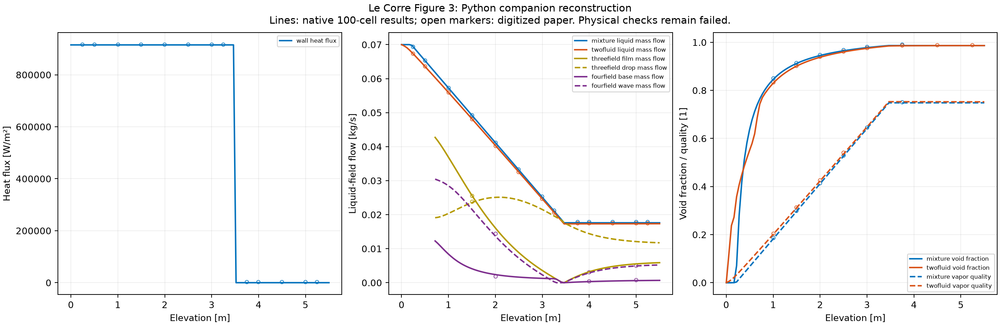
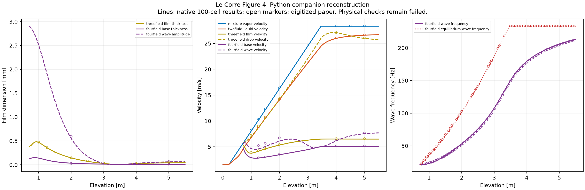
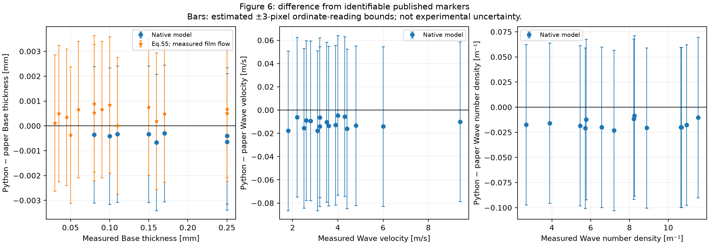
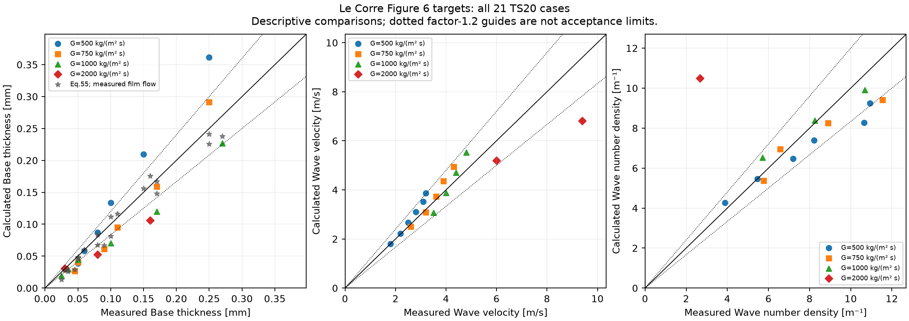
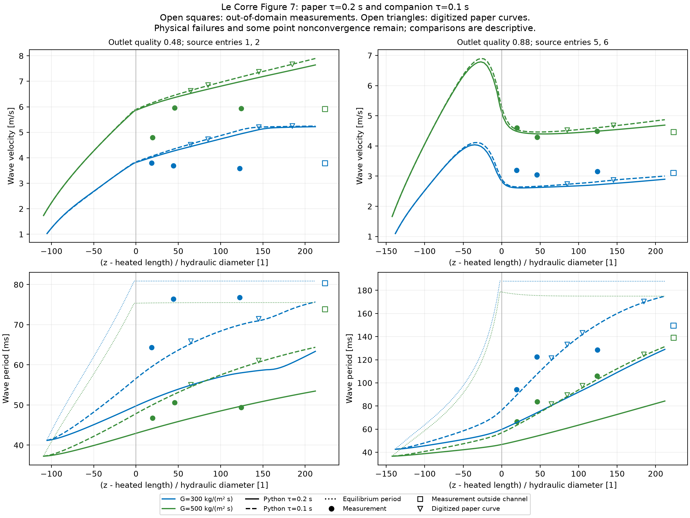

# Le Corre NURETH-21 reproduction and verification report

Target: J.-M. Le Corre, J. Chan, E. Walter, E. T. Hurlburt and R. W. Morse,
*OpenSTREAM: An Open-Source Platform for Two-Phase Flow Modeling and
Simulation*, NURETH-21 (2025), supplied as `LeCorre2025OpenSTREAM.pdf`.
This is distinct from the two ICMF abstracts and from the Bartolomey pilot.
Reproduction means retaining the specified cases and physics; it does not
mean choosing parameters that make the Python curves resemble a figure.

All 69 frozen calculations are complete: 33 source-default cases and 36
diagnostic refinements. They reproduce much of the published graphical
evidence. Exact publication-runtime equivalence and experimental validation
remain unestablished: historical input inconsistencies, six native
convergence failures and retained physical failures are documented below.
The paper's Sawai graphics agree more closely
with the code's 0.1 s relaxation than with the paper-text 0.2 s value; both
predeclared configurations remain in the comparison.

## Immutable targets and evidence levels

| Source | Identity | Evidence supplied |
|---|---|---|
| Supplied 14-page paper | SHA256 `f72e78c41036f84db849fb080187562777e6b6696b407b6bcce2b8ca9d11ada1` | Published conditions, model descriptions, plotted predictions and measurements |
| OpenSTREAM | `a614c7173822a93c1e64ac28d1541cbac028cbd8` | Pinned governing equations, closure implementations, defaults and numerics |
| CoolPropWrapper | `a7c40902ff66faf6ed668986398bb1b9faa16e13` | Property-backend/version target |
| OpenSTREAM-database | `b48541e6438a92b4c0ddc83cf0ceda3f71a59b22` | Experimental records and companion workflow |
| `database/projects/NURETH21.mlx` | SHA256 `f43f99a7a9dbfc0894748b97e05a1043379254d2cde39f59be5f3688ab8b960c` | Executable case definitions and their sequential inheritance; no numerical output-array entries |

The pinned companion is a later source artifact, not proof that its current
defaults, property version and solver revision generated every published
curve. The supplied PDF's plot panels are raster graphics, not embedded
full-precision arrays. Extracted plot coordinates, if used, are digitized
paper evidence with finite graphical resolution. They must not be described
as recovered MATLAB numerical arrays. The original four TUTORIAL1 archive
comparisons retain their own scope and do not certify these publication cases.

Original PDFs and full extracted paper text remain local. Citations, source
hashes, derived comparison data and analytical descriptions identify the
publication without redistributing it.

Historical inspection also recovered `projects/NURETH21.m` from database
commit `e550ff14435dcbd4c850cd655188e8b95c6ce873`; it was introduced in
`90facd57be3be3f3d7a6c7fa5b619cc0346134d1` on 2025-03-18. The current
MLX was introduced later, in `2ce844e90900db14a959881ad953b4d6852314f3`
on 2026-09-09. The historical demonstration contains material differences:
scalar `RELAXTCOND=0.5`, `SLIP=2`, commented explicit TwoFluid full-momentum
assignments, explicit ThreeField `VAPORFRIC=WALLIS`, and FourField
`VAPORFRIC=CONST`, `VAPORFRICCST=0.005`, `OAFBASERATIO='0.2'`.
The historical Sawai workflow also selects 0.1 s, retaining the conflict
with the paper's 0.2 s. Commented assignments do not establish their
effective values without the corresponding historical defaults.
Publication-era and pinned defaults differ as well. Therefore neither
workflow is silently substituted for the other or called the established
publication-producing configuration.

The original project source is preserved in
`references/paper/lecorre2025/NURETH21_2025_original.m`, with its MIT
source provenance and historical/default audit in `source_history.json`.
The historical solver selected by the audit is
`108a19b42cc3a0119d1ded8c78fca0fad9bf6c5a`, the latest available solver
commit on or before 2025-09-05; that date rule does not prove which version
produced the paper. Two concrete incompatibilities prevent calling the
unmodified historical script a runnable reference configuration:

- Its `VAPORFRIC='CONST'` does not match the historical or current enum's
  `CONSTANT` spelling.
- Its scalar `RELAXTCOND=0.5` is assigned directly by the historical input
  parser. Historical `Mixture.RELAXTCOND_CALC` indexes
  `model.RELAXTCOND(1:length(model.RELAXX))`, while the inherited `RELAXX`
  has five knots. No scalar expansion was found in the inspected parser
  or solver; this indexing would exceed the stored scalar's extent.

The second issue is an original script/solver compatibility inconsistency,
not evidence of a Python translation defect. Expanding 0.5 to five values
would be an inferred repair, so no such calculation is included here.
The historical string `OAFBASERATIO='0.2'`, by contrast, is unambiguously
written as `0.2` and read numerically by the source input writer/parser.
Further historical replay requires the actual plot-producing input files
or author clarification of the intended relaxation configuration. No
governing equation or global input alias was changed to resolve these gaps.

## Figure-to-case contract

| Figure | Native calculation target | Compared quantities | Scope condition |
|---|---|---|---|
| 3, PDF p.9 | One shared boiling-water case, separately solved by Mixture, TwoFluid, ThreeField and FourField | Prescribed wall heat flux; liquid/film/drop/base/wave mass flows; void fraction and vapor quality with source field definitions | Sequential companion model inheritance retained; full profiles and onset mask saved |
| 4, PDF p.9 | Field-resolved outputs from the shared four-framework demonstration | Film/base thickness, wave amplitude, field velocities, wave frequency and equilibrium frequency | Use the source annular-flow plotting range, not pre-onset initialization values as physical annular predictions |
| 5, PDF p.10 | Two-fluid and mixture comparison against TRACE | Phase variables for 0.6 MJ/kg inlet enthalpy and 150 kW | Complete reproduction unavailable: companion explicitly omits the missing TRACE reference case/results |
| 6, PDF p.11 | FourField, every Wurtz1978 record whose `TestName` is exactly `TS 20` | Outlet base-film thickness, wave velocity and wave number density | 21 source records; fixed measurement-informed entrainment coefficient; missing measured targets remain missing |
| 7, PDF p.12 | FourField, Sawai1989 one-based rows 1, 2, 5 and 6 | Axial wave velocity, wave time period and equilibrium period | Preserve separate paper `RELAXTW=0.2 s` and companion `RELAXTW=0.1 s` configurations; out-of-domain measurements explicitly excluded from interpolation |

The companion's Wurtz subset is a 7 MPa pipe subset. The paper's description
of the broader source experiment includes other pressures and an annulus;
those broader conditions are not silently added to the Figure 6 selection.

The raw selected Wurtz records contain 21 base-thickness, 17 wave-velocity
and 14 wave-number-density measurements: 52 present targets out of 63
possible targets. The four selected Sawai records each contain four
elevations with both measured quantities. One elevation per record exceeds
the stored length: 1.6932, 1.6926, 1.6923 and 1.6932 m for rows 1, 2, 5
and 6 respectively. Thus each relaxation variant has 32 raw targets,
of which 24 are within the stored channel and eight are outside it,
before applying any additional solver/annular-domain eligibility checks.

The frozen manifest is `examples/lecorre_reproduction.json`, canonical
SHA256 `1a2ad36cfedd15998eb85612987329e22b456fb2a0b9f17ea69ce31536c42172`.
It defines 33 source-default attempts (four demonstration frameworks,
21 Wurtz records and eight Sawai case/variant combinations). The numerical
study adds 200/400-cell runs and one tightened-iteration run for each of
12 fixed sentinels: all demonstration frameworks, first Wurtz record of
each selected mass flux (rows 1, 7, 13, 19), and all four Sawai paper-value
variants. The planned total is 69 attempts. Tightened runs multiply every
`ERROR*` and `SSCONV*` option by 0.1 and use `MAXITER=200`, `SSMAXITER=60`;
they retain the original 100-cell mesh and physical coefficients.

## Exact demonstration inputs and inheritance

All quantities below are the companion's stored values in SI units. Do not
replace explicit area/perimeter/enthalpy with values recomputed from the
paper's rounded 8.8 mm diameter and 1.14 MJ/kg inlet description.

| Input | Value | Unit |
|---|---:|---|
| Fluid | water | single component |
| Pressure | 6,000,000 | Pa |
| Mass flow | 0.07 | kg/s |
| Inlet enthalpy | 1,139,400 | J/kg |
| Total power | 87,500 | W |
| Length | 5.5 | m |
| Area | 0.000060821 | m2 |
| Perimeter | 0.0276 | m |
| Wall segment lengths | `[1.75, 1.75, 2.0]` | m |
| Relative wall power | `[1.0, 1.0, 0.0]` | 1 |
| Axial interpolation | `NEXT` | source selection |

The common option structure starts with `Dataset.inputOptions()`. Generated
input files obtain `NNODES=100` from `Dataset.makeInputFiles`; other unspecified
values retain pinned source defaults and the source writer's `%.11f` numeric
round-trip. No extra physical transient is introduced. The companion makes
no numerical-control override beyond axial interpolation. In particular,
the source defaults include `MAXITER=100`, `SSMAXITER=30`, `SSTSTEP=1 s`,
and `PROPERTIES=SATURATED`. These are reproduction settings, not a claim
that their numerical error is sufficiently small in every case.

The four model configurations are cumulative:

1. **Mixture:** no additional model overrides; homogeneous equilibrium.
2. **TwoFluid:** retain Mixture settings, then set `INTNU=RELAXATION`,
   `RELAXX=[-0.5,1.0]`, `RELAXCONDT=[0.5,0.5,0.01]`,
   `MOMENTLIQUID=FULL`, `MOMENTGAS=FULL`, `DROPDRAG=VISCOUS`.
3. **ThreeField:** retain the TwoFluid option structure, then set
   `MOMENTFILM=FULL`, `MOMENTDROP=FULL`, `DROPDIAM=0.001 m`.
4. **FourField:** retain the ThreeField option structure, then set
   `MOMENTBASE=FULLNOP`, `MOMENTWAVE=FULL`,
   `WAVEBASEINT=VAPORSHEARDROPMASS`, `OAFFILMSPLIT=RATIO`,
   `OAFBASERATIO=0.3`, `BASEEQTHICK=YPLUS`.

The demo inherits `RELAXTW=0.2 s` from the pinned model default, consistent
with the paper's demonstration description on PDF p.8. This differs from
the later explicit Sawai companion override discussed below.

## Exact experimental model selections

Each experimental section restarts from its dataset's fresh
`inputOptions()`; it does not inherit the demonstration or the other
experimental section. Geometry, heating, pressure, enthalpy and mass flow
come from the selected source XML records through the translated
`Dataset.makeInputFiles` contract. Preserve full effective input snapshots.

| Selection | Wurtz Figure 6 | Sawai Figure 7 |
|---|---|---|
| `THERMALNONEQ` | pinned default | `EPRI` |
| `VOID` | `BESTION` | `EPRI` |
| `TPFM` | pinned default | `EPRI` |
| `OAFENTRAINED` | `EQUILIBRIUM` | `EQUILIBRIUM` |
| `DEPOSITION` | `OKAWA` | `OKAWA` |
| `ENTRAINMENT` | `OKAWAGEN` | `OKAWA2003` |
| `OKAWACOEFS` | `[320, 0.111, 0.000350, 1]` | pinned default |
| `OAFFILMSPLIT` | `EQUILIBRIUM` | `EQUILIBRIUM` |
| `MOMENTBASE` | `FULLNOP` | `FULLNOP` |
| `MOMENTWAVE` | `FULL` | `FULL` |
| `VAPORFRIC` | source literal `CONST`; recorded migration to `CONSTANT` | same recorded migration |
| `VAPORFRICCST` | `0.005` | `0.005` |
| `WAVEBASEINT` | `VAPORSHEAR` | pinned default |
| `WAVEMIXCOEF` | pinned default | `2` |
| `THINFILMTHICK` | pinned default | `0.0001 m` |
| `THINWAVETHICK` | pinned default | `0.00001 m` |
| `SHAPEFACTORCOEF` | pinned default | `[132500, 2, 1, 0]` |
| `EQSTROUHAL` | pinned default | `SAWAI` |
| `RELAXTB` | pinned default | `0.5 s` |
| `WAVEFREQUENCY` | pinned default (`RELAXATION`) | `RELAXATION` |
| `RELAXTW` | pinned default (`0.2 s`) | `0.2 s` paper / `0.1 s` companion, separately named |

Wurtz outlet wave number density is `FREQUENCY/U_wave`, in m^-1; the stored
database `WaveNumberDensity` is the comparison target. It must not be
replaced by a recomputed frequency/velocity ratio without recording that
transformation and its rounding/correlation consequences. Base thickness
is stored in metres; paper axes use millimetres. Sawai wave period is
computed by the source as `1/FREQUENCY`, in seconds, and plotted in
milliseconds. Stored Sawai `WaveTimePeriod` numbers are milliseconds even
though one source plotting comment says seconds.

For Sawai, both measured and predicted coordinates use
`(z - heated_length)/Diameter`, with `heated_length=0.8 m` and
`Diameter=0.004 m`. Preserve raw elevations in metres and raw period
values in milliseconds beside SI values. A transformed coordinate does
not bring a measurement beyond `Length=1.648 m` inside the computational
domain.

The Wurtz base-thickness plotting helper adds a second calculated series:
the Le Corre (2022) equilibrium correlation, whose film Reynolds number
uses the **measured film flow**. Its points are distinct from the native
`base.THICK` prediction. Preserve this distinction in any Figure 6 overlay;
agreement of that measurement-informed correlation is not the solver's
base-film prediction. Inspection of Figure 7 also places the final measured
points beyond the end of its model curves. The stored channel end maps to
`(1.648 - 0.8)/0.004 = 212`, whereas the selected last measurement coordinates
map to approximately 223.1-223.3. This confirms the mismatch already appears
in the published graphical evidence, without resolving the underlying
coordinate inconsistency or authorizing extrapolation.

## Discrepancy register fixed before comparison

| ID | Source discrepancy or limitation | Required treatment | Acceptance linkage |
|---|---|---|---|
| LC-001 | Current companion and pinned 2026 implementation are not a documented publication-producing runtime/source bundle | Identify them as the current-companion reconstruction; retain paper and source hashes, complete inputs and actual property versions | EXP-001, EXP-013 |
| LC-002 | Companion uses `VAPORFRIC='CONST'`; pinned enum accepts `CONSTANT`, `WALLIS`, `WALLISTHICK`, `SOLVER_DEPENDENT` | Keep literal input rejection. At the publication runner only, explicitly map this one documented spelling to the intended fixed coefficient 0.005; log original/effective selections. Do not add a global alias or choose a different friction law | EXP-001, EXP-010, EXP-011 |
| LC-003 | Paper Figure 7 selects 0.2 s relaxation; companion code and prose select 0.1 s | Execute separately labeled paper-value and companion-value branches. Do not select the better-fitting result after inspection | EXP-001, EXP-011, EXP-014 |
| LC-004 | Each selected Sawai record contains a measured elevation outside the stored 1.648 m channel | Retain every raw measurement; mark out-of-domain exclusions explicitly. No clamping, extrapolation, coordinate shifting or length extension to obtain agreement | EXP-006, EXP-012 |
| LC-005 | Sawai measurement period comment conflicts with numerical values and plot units | Record raw milliseconds; convert by 0.001 to seconds for calculation/error accounting, and use explicit plot units | EXP-006, EXP-012 |
| LC-006 | Wurtz `OKAWACOEFS` reduction and Sawai relaxation selection are measurement-informed | Call these calibration-associated reproduction cases, not independent holdout validation | EXP-014 |
| LC-007 | Original TRACE case/results are absent from the companion | Mark Figure 5 not reproduced. Rounded paper conditions alone do not define the exact TRACE or OpenSTREAM closure/numerical configuration | EXP-004 |
| LC-008 | Numerical arrays for the published predictions are absent; plot panels are raster images | Report digitized/visual comparisons at their stated resolution. Do not apply archived-array tolerances or claim MATLAB equivalence from graphical similarity | EXP-002, EXP-010, EXP-011, EXP-013 |
| LC-009 | Existing annular physical-consistency failures and frequency stopping limitations may occur in these new cases | Save original output and diagnostics, require separate numerical/frequency/onset/nested-closure checks, and retain failed physical criteria even if curves agree | CORE-028, CORE-033, EXP-008 |
| LC-010 | Recovered 2025 `.m` workflow differs materially from the 2026 MLX and does not resolve the paper's Sawai relaxation conflict | Preserve a separate historical configuration/default audit. Do not edit the frozen current-companion campaign to improve agreement or claim either runtime is established as the publication-producing one | EXP-001, EXP-002, EXP-011, EXP-013 |
| LC-011 | Figure 6 base-thickness panel includes both the solver prediction and a separate correlation using measured film flow | Label and compare the two calculated series separately; do not assign the correlation's agreement to native `base.THICK` | EXP-006, EXP-010, EXP-014 |
| LC-012 | Historical script sets scalar `RELAXTCOND=0.5`; the inspected 2025 source indexes it using five inherited `RELAXX` knots with no scalar expansion | Preserve the literal source inconsistency; obtain the actual generated input before any claimed historical replay. Do not silently broadcast a constant or classify this as a native port defect | EXP-001, EXP-002, EXP-013 |
| LC-013 | Figure 3/4 annular-onset marker is approximately 0.71 m at the available raster resolution, while the paper prose gives 0.77 m | Preserve graphical reading bounds and the separate text value. Report both comparisons rather than selecting the reference that agrees better | EXP-002, EXP-006 |
| LC-014 | Sawai entries 1 and 5 reach the source temporal stopping condition while final point iterations still fail | Keep the source state and failed native-convergence flag together; report saved iteration changes, unchanged thresholds and affected nodes. Do not describe this as a wave-frequency failure or change stopping rules to clear it | EXP-008, EXP-011, CORE-033 |
| LC-015 | The source annular blending profile changes physical width with the mesh even when `OAFTRANSITION` is held fixed | Retain the source formula and original pairwise metrics. Distinguish changed eligibility domains and changed blending from pure discretization error; use any common-coordinate analysis only as a labeled posthoc diagnostic | EXP-007, EXP-010, EXP-011, CORE-033 |

## Acceptance and accounting protocol

This protocol is established before evaluating the newly calculated errors.

- **Input fidelity:** case selection, model choices, inherited defaults,
  explicit stored geometry/boundary values, properties and units must be
  traceable. Every deliberate difference has a named discrepancy/variant.
  A missing publication-time value remains unknown; a pinned default is a
  documented reconstruction choice, not recovered historical metadata.
- **Reproduction first:** execute the companion-derived 100-cell controls
  without tuning. Any tighter-control or mesh follow-up is a separate
  configuration retaining the original attempt and reason for the change.
  Scientific options are not silently changed after failures.
- **Convergence:** save source solver state, the stricter native convergence
  flag, precursor convergence, wave-frequency convergence, onset convergence,
  nested closure failures, iteration histories, warnings and execution/export
  errors. A source `SOLVEDCONVERGED` state alone does not close all these gates.
- **Physical consistency:** use the existing source-equation and integrated
  diagnostics, including mass/transported enthalpy, phase partitions, positivity,
  finite state, frequency and occupied-area geometry. The existing relative
  annular area criterion is 1e-6. Apply it only to numerically unblended annular
  nodes (`AFFNC >= 1 - 1e-12`). No eligible region means unknown, not pass.
  Retain the source's clipping and one-way mixture pressure/energy coupling.
  Do not invent a total-energy or independent multifield-pressure validation
  claim from the transported-enthalpy/precursor equations.
- **Matched quantities:** compare Wurtz outlet quantities and Sawai
  within-domain axial quantities in identical units. Keep measured, derived,
  equilibrium-reference and paper-digitized quantities distinct. Preserve
  missing/out-of-domain observations and all attempted cases.
- **Comparison statistics:** signed prediction-minus-reference errors,
  bias, MAE and RMSE are descriptive. No universal relative error is computed
  near zero. Unknown measurement/digitization/numerical uncertainty prevents
  an uncertainty-qualified experimental pass. Plot guide bands are not a
  general acceptance threshold. Graphical comparisons cannot establish
  full-precision agreement; the original archive tolerances remain unchanged.
- **Numerical sensitivity:** report differences at matched coordinates only
  when both configurations satisfy their convergence/domain gates. No
  asymptotic order or continuum uncertainty estimate is claimed without a
  suitable refinement sequence. A failed source-default run remains failed
  even if a separately named tighter run converges.
- **Status axes:** implementation, native checks, MATLAB equivalence,
  physical consistency and experimental comparison remain independent in
  `docs/acceptance/experimental.json`. New evidence changes only the rows
  and scopes it supports; all 81 existing requirement IDs and criteria stay
  stable. Figure 5 and unverified publication-time metadata remain open.

An independent saved-output audit is implemented in
`tools/audit_lecorre_outputs.py`. It imports no solver, native database
adapter or campaign-comparison routine. It reads the pinned raw XML and
saved arrays directly, checks source-input decimal precision, array shapes,
units, discrete wall-power integration, reported transported enthalpy and
mass deviations, `period=1/frequency`, `number density=frequency/velocity`,
all observation populations, domain exclusions, paired CSV values, signed
errors and descriptive statistics. Its floating-point tolerances test
arithmetic/serialization only; decimal rounding bounds are not experimental
uncertainty estimates. An arithmetic-audit pass cannot clear a physical
failure, prove MATLAB equivalence or establish experimental accuracy.
Each audit receipt hashes the report and its own script, preserves failed
physical statuses, and is written to a new file rather than overwriting
earlier evidence.

## Observed convergence failures

Both source-default Sawai entry-1 variants stop at initialization pseudo-time
8 s, and both entry-5 variants at 7 s, with source state
`INITIALSTEPCONVERGED`. Their frequency, onset and
reported nested-closure gates pass, but native `converged` is false. The
saved final point changes identify the reason:

| Case / variant | Max wave change [kg/(s m)] | Strict limit [kg/(s m)] | Failed nodes (zero-based) | Max location [m] |
|---|---:|---:|---|---:|
| Sawai 1, paper 0.2 s | 0.0007676067362 | < 0.0001 | 24, 25, 26 | 0.39552 |
| Sawai 1, companion 0.1 s | 0.0007676023561 | < 0.0001 | 24, 25 | 0.39552 |
| Sawai 5, paper 0.2 s | 0.0002156314587 | < 0.0001 | 15 | 0.24720 |
| Sawai 5, companion 0.1 s | 0.0002156314261 | < 0.0001 | 15 | 0.24720 |

The failed nodes exhaust `MAXITER=100`. For entry 1 the largest change
occurs just downstream of the 0.37904 m annular-onset position, with
`AFFNC=0.99768946` at node 24. Entry 5 fails at its onset node with
`AFFNC=0.5`. The other five saved final point criteria pass. These are
successive-iteration changes in mass flow divided by wetted perimeter,
not governing-equation residuals. The source's temporal stopping predicate
does not require point convergence; the native convergence flag retains
this additional rejection. The governing equations, point tolerances,
temporal stop and original failed attempts remain unchanged. Separate
refinement/tighter-control runs cannot retroactively certify these
source-default attempts.

The separately preregistered entry-1 tightened run also stops with point
failures, at pseudo-time 10 s. Its maximum wave-flow-per-perimeter change
is 0.0006427002943 kg/(s m), versus the tighter 0.00001 limit; its maximum
wave-velocity change is 0.00162855423 m/s, versus 0.001. Both fail at nodes
24–26 after 200 iterations, with maxima at 0.39552 m. The entry-1 200-
and 400-cell runs converge natively, but this does not clear either the
original 100-cell failure or the tightened-run failure. Sensitivity
comparisons involving a nonconverged configuration remain unavailable.

The 400-cell TwoFluid demonstration instead fails the temporal liquid-
enthalpy criterion. At its final initialization pseudo-time 29 s,
the maximum change from the preceding pseudo-step is 2.07523442 J/kg at
the outlet, versus `SSCONVH=1 J/kg`. The other five temporal criteria and
all final point-iteration criteria pass, and the precursor converges.
It reaches the unchanged `SSMAXITER=30` history limit with source state
`INITIALSTEPNOTCONVERGED`; this is not a point-iteration or wave-frequency
failure. All failed-run criteria, maxima, locations and thresholds are
retained in the independent output audit's `convergence_diagnosis` records.

The source-coupling and inventory audit is documented separately in
`docs/LECORRE_PHYSICAL_REVIEW.md`, with machine-readable evidence in
`references/paper/lecorre2025/physical_scope_review.json`. It reproduces
the 31 base-run annular area maxima directly from saved arrays. It also
distinguishes transition-region negative drop-flow diagnostics from the
applicable unblended annular area failures; no original flag is erased.

## Reproducible Windows commands

From the project directory, run a new campaign into a new output directory:

```powershell
.\.venv\Scripts\python.exe tools\run_lecorre_reproduction.py --output outputs\validation\lecorre-replay-01
.\.venv\Scripts\python.exe tools\audit_lecorre_common_domain.py outputs\validation\lecorre-replay-01 --output outputs\validation\lecorre-replay-01\common_domain_diagnostic.json
.\.venv\Scripts\python.exe tools\compare_lecorre_results.py --campaign outputs\validation\lecorre-replay-01 --output outputs\validation\lecorre-replay-01\analysis
.\.venv\Scripts\python.exe tools\audit_lecorre_outputs.py outputs\validation\lecorre-replay-01 --output outputs\validation\lecorre-replay-01\independent_output_audit.json
```

The runner refuses altered frozen source inputs and existing output
directories. Its exit code 3 means that at least one executed run did not
satisfy its convergence/physical gates; inspect the report rather than
interpreting this code as missing output. Every attempt remains saved.
The comparison and audit commands operate on saved arrays and do not
rerun a solver. Their output destinations must also be new.

`outputs/validation/lecorre-2025-01/executed_runner.py` preserves the
runner actually launched for this campaign. The canonical runner later
received guards rejecting malformed observation array shapes; the saved
campaign used valid shapes, so these guards do not change its calculations.
The executed snapshot remains the provenance record for this run. Native
solver/adapter startup fingerprints are retained and checked against
per-run metadata; helper changes are not presented as new solver physics.
The final analysis also records its own postprocessor source identity.

The two paper-reference extraction scripts were rerun in their pinned
optional environment (Python 3.12.14, NumPy 2.3.5, Pillow 12.3.0 and
pypdf 6.10.0). All five generated reference CSV/metadata files were byte
identical; the receipt is
`outputs/verification/lecorre-paper-extraction-replay.json`.
This verifies deterministic extraction, not independent correctness of
the selected pixel positions, graphical calibration or measurement data.

The command order is intentional: common-domain receipt, final analysis,
then independent output audit, after the solver campaign. The comparator
binds the common-domain receipt to the report and manifest; the final audit
hashes the completed analysis and independently verifies its aggregate
measurement statistics. The physical-scope audit is a separate read-only
operation and is not a prerequisite for these commands.

The common-coordinate diagnostic was introduced after observing changing pairwise eligibility domains;
it is explicitly posthoc. All four 100/200/400-cell and 100-cell-tight
configurations must converge natively before a sentinel is eligible.
Every comparison then uses the same original 100-cell coordinates and
the intersection of finite eligible interpolation brackets across all
four configurations. Original results, pairwise metrics and criteria
remain unchanged.

Each run contains `submitted_inputs.json`, `effective_inputs.json`,
`gui_inputs.json`, numerical NPZ/CSV files, units, diagnostic assessment
and paired measurement records. Import its `gui_inputs.json` through
the local application's **Import** control to inspect or rerun that
configuration; edited runs are separate cases and are not automatically
part of this frozen reproduction campaign.

## Completed campaign and independent checks

| Cohort | Attempts completed | Natively converged | Physical rejection | Not fully physically assessed |
|---|---:|---:|---:|---:|
| Four demonstration frameworks and diagnostics | 16 | 15 | 12 | 4 |
| Wurtz source cases and diagnostics | 33 | 33 | 33 | 0 |
| Sawai source variants and diagnostics | 20 | 15 | 20 | 0 |
| Total | 69 | 63 | 65 | 4 |

All six native-convergence failures have explicit saved-array diagnoses:
the four Sawai entry-1/entry-5 source-default variants, the entry-1
paper-value tightened run, and the 400-cell TwoFluid demonstration.
The separately tightened entry-5 calculation converges, while its
original source-default failures remain unchanged. The runner's final
exit code 3 reflects these retained native/physical rejections.

The independent output audit passes all **4,708 arithmetic, provenance,
unit, domain, population and saved-output checks** across the 69 runs.
It also independently reconstructs all seven aggregate measured-error
groups from the raw XML and saved profiles. This is verification of
reported calculations and accounting, not a physical-validation score.
The audit preserves every original native and physical rejection.

The final local automated suite completed with **476 tests passed and
two retained FourField runtime warnings in 176.12 s**. The warnings are
the existing divide-by-zero and invalid-multiply evaluations in the
original-input FourField test; they were not suppressed or removed to
obtain this result. The complete log is
`outputs/verification/lecorre-native-tests-final.log`. Passing software
tests does not clear the separately reported physical failures or
establish experimental validity.

Of the 36 preregistered pairwise numerical-sensitivity comparisons,
31 have two natively converged configurations and five remain unavailable.
All unavailable comparisons are retained with their exact failed-run
reasons. The posthoc common-coordinate diagnostic admits nine of 12
sentinels under its stricter all-four-configurations requirement;
TwoFluid, Sawai entry 1 and Sawai entry 5 remain excluded. The Sawai
refinement cohort uses the paper-value 0.2 s setting only; the 0.1 s
configuration has no corresponding mesh/tighter-control cohort here.
These are descriptive diagnostics, with no experimental accuracy,
continuum uncertainty or full mesh-independence acceptance claim.

## Source-default results

All 33 frozen source-default cases executed. All four demonstration cases
and all 21 selected Wurtz cases passed the native convergence check. Four
of the eight Sawai case/relaxation variants passed; entries 1 and 5 failed
point convergence under both relaxation settings. All 32 field-resolved
source-default runs retain a physical-consistency rejection. The Mixture
demonstration is marked `not_fully_assessed`, not given a complete physical
pass from the limited checks. Diagnostic mesh/tighter-control runs are
accounted separately from these source-default results.

The execution environment recorded Python 3.12.14, openstream-python
0.2.1, NumPy 2.5.4, SciPy 1.18.1, CoolProp 8.0.0 and Matplotlib 3.11.2.
The report and per-run metadata retain exact native source fingerprints;
the independent audit checks their consistency across saved runs.

The demo precursor integrates to 87,500 W prescribed wall power, with
87,499.9990006 W transported enthalpy gain (relative difference
1.14212e-8) and maximum steady mass-flow deviation 7.90175e-10 kg/s.
These are checks of the implemented transported-enthalpy formulation, not
a general total-energy validation. The demonstration's maximum relative
occupied-area discrepancies are 0.410561 for TwoFluid, 0.0748526 for
ThreeField and 0.0748884 for FourField, against the unchanged 1e-6
geometry-identity criterion. The ThreeField/FourField values use only
unblended annular nodes. Agreement with the paper's curves does not clear
these failures. A fresh MATLAB comparison for these exact new cases has
not established whether each discrepancy is shared with upstream.

### Comparison with the published curves

The plotted reference values are digitized paper graphics with explicit
horizontal and vertical reading bounds, not recovered numerical arrays.
The comparison retains the source calibration and extraction exclusions.

- **Figures 3–4:** sampled readings from 21 of the 22 extracted series
  intersect the native-curve reading envelopes at every retained point.
  Three of five sampled FourField wave-velocity points do not intersect
  them; the series RMSE is 0.499978 m/s. The FourField wave-frequency
  RMSE is 1.11900 Hz, and equilibrium-frequency RMSE is 0.809312 Hz.
  Frequency series have far more extracted points than several other
  series, so an overall graphical agreement percentage would be misleading.
- **Figure 6:** all 39 identifiable native prediction dots intersect their
  graphical reading envelopes, as do the 15 separately identified
  measured-film-flow correlation stars. The stars are a different
  calculation; their agreement is not attributed to native base thickness.
  Unidentifiable/overlapping plot points remain excluded in the reference
  metadata rather than assigned invented values.
- **Figure 7:** all 24 retained model-curve readings intersect the envelopes
  for the companion's 0.1 s configuration; only two intersect for the
  paper-text 0.2 s configuration. This supports the interpretation that
  the plotted curves are more consistent with the code's 0.1 s setting.
  It does not establish the original plot-producing inputs or resolve
  the text/code discrepancy by changing the requested parameter.
  The dotted equilibrium-period curves use the 0.2 s branch and are
  plotted as model references; they
  are not measured targets and have no separate digitized comparison in
  this extraction.
- **Annular onset:** the 100-cell demo gives 0.715 m, consistent with the
  approximately 0.71 m raster marker at its reading resolution. The
  separate paper-text value is 0.77 m and remains a recorded discrepancy.

The original script incompatibilities, changed historical defaults and
missing full-precision reference arrays prevent a claim of exact
publication-runtime replay or MATLAB numerical equivalence.







### Comparison with the stored measurements

The following source-default RMSE values are descriptive prediction-minus-
measurement errors. They include predictions from physically rejected
runs, and the Sawai populations include nonconverged cases explicitly.
No uncertainty-qualified experimental acceptance threshold has been
established.

| Selection | Quantity | Compared / raw targets | RMSE | Unit |
|---|---|---:|---:|---|
| Wurtz, 21 TS 20 cases | Base thickness | 21 / 21 | 3.75347e-5 | m |
| Wurtz, 21 TS 20 cases | Wave velocity | 17 / 21 | 0.750053 | m/s |
| Wurtz, 21 TS 20 cases | Wave number density | 14 / 21 | 2.35742 | m^-1 |
| Sawai, paper 0.2 s | Wave velocity | 12 / 16 | 0.703085 | m/s |
| Sawai, paper 0.2 s | Wave period | 12 / 16 | 0.0252651 | s |
| Sawai, companion 0.1 s | Wave velocity | 12 / 16 | 0.764504 | m/s |
| Sawai, companion 0.1 s | Wave period | 12 / 16 | 0.0101516 | s |

The 11 Wurtz exclusions are absent source measurements. Each Sawai
variant excludes eight quantity/location targets outside the stored
channel, four for each quantity. Only six of the 12 compared Sawai points
per quantity come from natively converged cases. All compared targets
come from cases with retained physical-consistency failures. The source
records contain 84 present measurement targets in total across these
selected populations; running two relaxation variants or additional
meshes does not create independent experimental observations. Both
datasets remain calibration-associated reproduction evidence, with
measurement/digitization/input uncertainty and independent holdout
status unresolved.





## Mesh dependence of the source transition

The first `OAFTRANSITION` parameter is described as a sigmoid width in
metres in upstream `Model.m:24`. Upstream `Mixture.m:2153–2155` multiplies
it by `N/L`; `sigm` at line 2206 then applies this coefficient to a node-
index difference. The Python implementation in `fields.py:530–537`
preserves the same expression, including the equivalent index-origin
shift. With uniform `dz=L/N`, first parameter `w` and second parameter
`offset`, the logistic argument is
`a = w * (z - z_onset - offset) / dz^2`, and
`AFFNC = 1 / (1 + exp(-a))`.

For positive `w`, the characteristic physical transition length is
`dz^2/w`. Doubling the mesh therefore reduces this length by four; a
fixed stored parameter does not preserve the same physical blending
profile. This is a source-backed parameter-semantics concern, not a
demonstrated Python translation error. No formula or input was changed.
Near annular onset, the present refinement study changes both the
discretization and the transition profile, preventing a clean estimate
of discretization error alone.

For Wurtz entries 1 and 7, the first numerically unblended annular nodes
are at 2.25, 0.585 and 0.1575 m on the 100-, 200- and 400-cell meshes.
The original pairwise comparison consequently uses 76 eligible coarse
coordinates for 100→200 and 188 for 200→400. Its maximum base-thickness
differences increase from 1.04194e-6 to 6.67092e-6 m for entry 1 and
from 1.18359e-6 to 8.66177e-6 m for entry 7. These maxima come from
different coordinate populations and cannot by themselves establish
nonmonotone error or divergence.

On the same 76 coarse coordinates at or above 2.25 m, an independent
read-only calculation instead gives decreasing differences:

| Case | 100→200 max base-thickness change [m] | 200→400 max change on the same coordinates [m] |
|---|---:|---:|
| Wurtz entry 1 | 1.04194e-6 | 2.83545e-7 |
| Wurtz entry 7 | 1.18359e-6 | 5.47068e-7 |

The full posthoc common-coordinate receipt applies this policy to all
12 sentinels, with nine eligible and three excluded because at least one
required configuration is nonconverged.
Neither decreasing differences nor common coordinates remove the
source transition-profile change. No convergence order, continuum
uncertainty, mesh independence or new acceptance threshold is claimed.

## Source locations

- `database/projects/NURETH21.mlx`: source case definitions and plotting logic.
- `database/@Dataset/Dataset.m`: `inputOptions`, selection and dataset behavior.
- `database/@Dataset/makeInputFiles.m`: stored-input/default/override mapping.
- `database/+Wurtz1978/@Wurtz1978/plotResults.m`: outlet target definitions.
- `database/+Sawai1989/@Sawai1989/plotResults.m`: axial coordinate and period display.
- `upstream/+Inputs/Model.m`, `upstream/+Inputs/Options.m`: pinned defaults.
- `upstream/+InputEnums/VAPORFRIC.m`: accepted friction choices.
- `src/openstream/output.py`, `twofluid.py`, `threefield.py`, `fourfield.py`,
  `multifield_output.py`: existing portable outputs and diagnostic scope.

Complete numerical evidence is saved in
`outputs/validation/lecorre-2025-01/report.json` and the corresponding
per-run directories. Final comparisons and plots are in its `analysis`
directory. `independent_output_audit.json` accounts for all 69 frozen
attempts, while `common_domain_diagnostic.json` retains the separate
posthoc study and `physical_scope_audit.json` independently audits the
33 source-default cases. Source inputs, equations, original reference
results and acceptance tolerances were not changed to obtain agreement.
