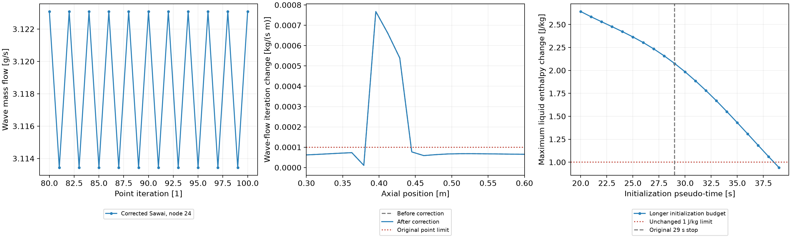

# Matched diagnostic replay: Sawai 1 and TwoFluid 400 cells

Completed native calculations on 2026-11-15 (America/Chicago). **One confirmed
FourField translation error was corrected. Sawai point nonconvergence remains.
TwoFluid needs additional initialization steps in this native case. Fresh MATLAB
equivalence remains unverified because no matching arrays or MATLAB access are
available.** No governing equation, closure coefficient, stopping predicate or
acceptance tolerance was changed.

## Frozen scope and reproducibility

Commit `178ac2b4152b31016dc8847aebab139de0d88d2d` preregistered
`examples/matched_diagnostic_replay.json`, including 45 immutable input/output
hashes and the source/submodule pins. Execution order was:

1. Sawai entry 1, author-intended tau=0.2 s, 100 cells.
2. TwoFluid demonstration, 400 cells.

The original inputs, all numerical controls and property backend were retained.
Read-only Python line tracing observes actual local variables, closure return
values and stored arrays; it does not re-evaluate properties or alter solver
methods. `native-before-02/` reproduced **400 arrays exactly**: 215 for Sawai and
185 for TwoFluid, covering physical profiles, initialization histories and the
mixture precursor. Shape, dtype, numeric values and NaN locations agree. This is
native reproducibility, not a MATLAB comparison or a claim about signed-zero bits.
All 45 original artifact hashes remain unchanged.

An initial observer attempt failed while serializing a NumPy array to JSON,
before capturing any point trace. Its evidence is retained under `native-before/`;
the observer was fixed and rerun into a new directory. This was an instrumentation
failure, not an additional numerical convergence failure.

## Confirmed translation error and isolated correction

MATLAB FourField `solve.m:83` uses a copy of the physical-time-zero mixture for
the outer initialization sweep. Its field closures intentionally retain other
mixture handles: aggregate film/drop use copies of the final precursor
initialization state, while base/wave have the physical mixture handle.
Python previously used `film.mix` for the outer sweep as well.

The two precursor states have identical primary W/P/H in this Sawai case, but
different cached quantities and phase velocities. The wrong object therefore
affected droplet-flow subtraction and full-momentum velocity limiting/blending.
The fix explicitly passes the physical precursor to the outer initialization
sweep and the corresponding time-indexed precursor for a physical transient.
It does not rebind film, base, wave or drop closures and does not replace any
equation. The original tutorial baseline did not expose the mismatch because
its two precursor states coincide.

Evidence includes exact source anchors, independently recovered MATLAB archive
handle relationships, unequal-cache regression fixtures, and an AST audit that
allows only four edits: the initialization call, transient call, required
precursor argument and local assignment. All other 24 native modules are
unchanged. See [Sawai source audit](replay_sawai_source_audit.md),
`precursor_handle_audit.json` and `precursor_change_audit.json` in the evidence
directory. This proves a source-selection translation correction; it does not
prove numerical equivalence of this new Sawai case to MATLAB.

## Results after correction

| Case / check | Observed result | Interpretation |
|---|---|---|
| Sawai 1, same frozen inputs | Stops at 8 s; final point failures remain at zero-based nodes 24-26 (z=0.39552-0.42848 m) | Source temporal stopping and native point acceptance remain distinct |
| Maximum final wave-flow point increment | Before: 0.0007676067362; after: 0.0007675963972 kg/(s m); unchanged limit: 0.0001 | Correction does not resolve the point failure |
| Largest final wave-velocity change caused by correction | 0.001258350293 m/s, at z=0.37904 m | Measured before/after sensitivity, not MATLAB error |
| Largest final wave-frequency change | 0.000700240419 Hz | Same scope; no curve fitting |
| Droplet velocity profile | Exactly unchanged | Its original closure handle was retained |
| TwoFluid 400, original 30-state budget | Exactly reproduces original arrays and fails at 29 s; liquid enthalpy change 2.075234421 J/kg exceeds 1 J/kg | No confirmed causal translation error; all final point criteria pass |
| Four archived TUTORIAL1 baselines | All four core, initialization and precursor comparisons pass again | Original rtol=1e-8, atol=0 and exact reference zeros retained |

At Sawai node 24, late wave-flow iterates alternate between approximately
0.003113437865 and 0.003123083481 kg/s. The nondecaying alternation is visible
in the saved trace, so simply reaching another iteration limit would not
demonstrate convergence. Negative droplet-flow values also remain. No further
model or relaxation change was made to force this case to pass.

The first *observed* before/after difference in the selected trace is already
present at node 20, pseudo-time 1 s. Nodes 1-19 were not traced at every iteration;
that observation must not be labeled the global first divergence. The complete
saved profiles and histories remain available, with the trace domain explicitly
recorded in each `trace_schema.json`.

## Separate TwoFluid initialization-budget diagnostic

Commit `3e6ca80` preregistered `examples/twofluid_initialization_budget.json`.
The only changed input is **SSMAXITER: 30 to 60**. Mesh, pseudo-time step, all
point/temporal tolerances, relaxation values, equations and closures remain
unchanged. This is a separate sensitivity run; defaults and the frozen matched
case were not edited.

The calculation reaches source and native convergence at **39 s**, after 40
stored states. Its maximum liquid enthalpy change is **0.9414000483 J/kg**, below
the original 1 J/kg threshold. The first 30 initialization states and the entire
mixture precursor match the original exactly. This supports an insufficient
initialization-budget explanation for the original native temporal rejection.

It does not clear the separate TwoFluid area diagnostic: its maximum relative
occupied-area discrepancy remains approximately **0.409488 (40.9488%)**.
This specific extended 400-cell result has no matched MATLAB reference. The
original 100-cell archive already independently demonstrates a similar area
discrepancy, but it does not certify the new magnitude.



Left: corrected Sawai node-24 late wave-flow iterations. Middle: original and
corrected final wave-flow increments, with the unchanged point limit; the two
curves nearly overlap. Right: the separately extended TwoFluid initialization,
showing the original 29 s limit and unchanged enthalpy-change threshold. These
are iteration diagnostics, not physical transient measurements. Figure titles
are omitted; axes, units and legends are retained.

## Verification and its limits

- All four archived baselines pass; the FourField maximum core relative
  difference remains 2.539609693e-9, below the unchanged 1e-8 criterion.
- The local full test collection passed 529 tests with the two existing
  FourField zero-slip warnings. A final observer/auditor check passed 30 tests,
  including a completeness guard added after that full collection began.
  Frontend checks passed 11 tests. Clean Windows CI is recorded separately
  when completed; local counts are not silently promoted to CI evidence.
- Independent arithmetic audits passed 13,368 Sawai and 9,326 TwoFluid checks
  for each before/after replay. They reconstruct observed updates and temporal
  differences from saved locals/arrays, without importing a solver. They do
  not independently validate uncaptured constituent force sums or raw HTOT
  values and are not a substitute for MATLAB execution.
- The final portable MATLAB kit has 230 checksummed files, 105 pinned source
  files and logging-only insertions in two solver files. Removing the hooks
  reconstructs the original source bytes. Seven static kit/comparator tests
  passed. MATLAB syntax/runtime and actual matched-reference comparison have
  not been executed. The user confirmed no MATLAB access currently.

The original 69-case paper reconstruction and published figures remain
immutable **pre-correction evidence**. They have not been recalculated or
reclassified as current-code results. Replaying affected cohorts, including
Wurtz and the other Sawai cases, remains an explicit acceptance item. The
same precursor-selection pattern in ThreeField requires a separate scoped
audit/replay before extending this correction there.

## Reproduce and continue

Use new output directories from the project root in PowerShell:

```powershell
.venv\Scripts\python.exe tools\replay_matched_diagnostics.py --purpose correction-assessment --output outputs\my-matched-replay
.venv\Scripts\python.exe tools\audit_matched_replay.py outputs\my-matched-replay --output outputs\my-matched-replay\independent-audit.json
.venv\Scripts\python.exe tools\diagnose_twofluid_initialization_budget.py --output outputs\my-twofluid-budget
.venv\Scripts\python.exe tools\verify_all_baselines.py --output outputs\my-baseline-check
```

The current implementation intentionally differs from the original Sawai
record; `correction-assessment` reports those differences without relaxing the
comparison or declaring them equivalent. To reproduce the pre-correction
attempt, use its recorded source revision and executed observer snapshot in
an isolated checkout. All replay evidence is under
`outputs/verification/matched-replay-01/`, including `final_comparison.json`
with SI units, source hashes and numerical changes.

The next diagnostic target is Sawai's alternating point iteration: extend
source-aligned observation to earlier nodes and the individual exchange/
equilibrium branches, preserving both handles and update order. Do not tune
coefficients or change stopping rules to hide the failure. Independent
reference execution remains the decisive pending check for full new-case
MATLAB attribution. The [acceptance matrix](ACCEPTANCE_MATRIX.md) records
these open items separately from the corrected translation error.
