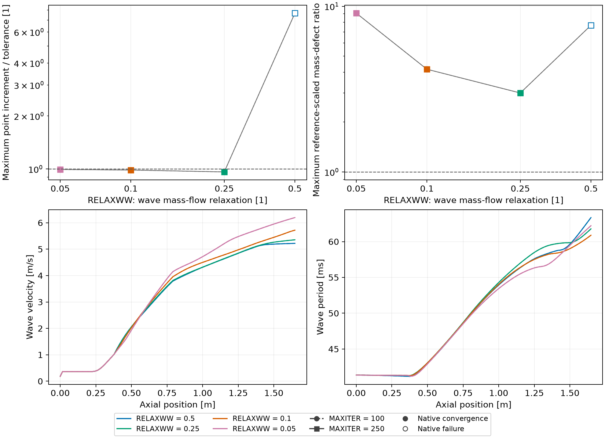

# Sawai entry 1: relaxation and iteration-control study

Date: 2026-11-15. FourField, physical wave relaxation time `RELAXTW=0.2 s`,
100 cells. **All governing equations, closure models and application defaults
remain unchanged.** The project-wide requirement is recorded in `AGENTS.md`.

## Result and scope

All eight preregistered runs completed. Six meet OpenSTREAM's unchanged native
convergence criteria. None meets the separate, preregistered numerical-adequacy
screen based on the final common-state wave mass equation. Increasing MAXITER
from 100 to 250 does not materially change these results. Lower relaxation
therefore improves the native convergence count, but this study does not
establish a control setting that resolves the numerical concern at the fixed
comparison scale. No production default is selected.

This is a numerical-control study, not an experimental comparison or a new
physical closure requirement. The native passes remain passes. The separate
mass-defect screen does not replace their status, alter the solver, or add an
annular phase-volume convergence condition. No additional translation error
was confirmed. A matched MATLAB run remains unavailable, so this study cannot
establish whether MATLAB produces the same control sensitivity.

## Frozen inputs and provenance

The design was committed before any study simulation in
`a43298385963a248fc9dac2ffef517122724fb77`. The runner was committed at
`c89952f` before execution. The complete specification is
`examples/sawai_control_study.json`; independent reviews are
`docs/sawai_control_study_design_review.md` and
`docs/sawai_control_implementation_review.md`.

| Quantity | Retained value or scope |
|---|---|
| Database case | Sawai entry 1; same effective physical inputs as corrected `sawai-01-paper-tw020-n100-base` |
| Framework / mesh | FourField; 100 cells, 101 stored axial nodes |
| Physical relaxation time | RELAXTW = 0.2 s, unchanged |
| Channel length / area / wetted perimeter | 1.648 m / 1.2566e-5 m² / 0.012566 m |
| Derived hydraulic diameter / cell length | 4A/P = 0.004 m / dz = 0.01648 m |
| Initialization step / limit | SSTSTEP = 1 s / SSMAXITER = 30 |
| Base mass relaxation | RELAXWB = 0.5 |
| Varied wave mass relaxation | RELAXWW = 0.5, 0.25, 0.1, 0.05; dimensionless numerical factors |
| Varied point-iteration cap | MAXITER = 100, 250 |
| Tolerances and other settings | All ERROR*, SSCONV*, momentum/frequency controls, closure coefficients and boundary conditions unchanged |

MAXITER is a positive uint8 in the OpenSTREAM source, so 250 is source-supported
and retains the even iteration parity of 100. The existing Python validator
rejects values above 255. This experiment does not silently widen that range.

OpenSTREAM remains pinned at `a614c7173822a93c1e64ac28d1541cbac028cbd8`,
CoolPropWrapper at `a7c40902ff66faf6ed668986398bb1b9faa16e13`, and the database
at `b48541e6438a92b4c0ddc83cf0ceda3f71a59b22`. The corrected reference and all
25 native Python modules are hash-bound in the manifest. Each attempt binds
its executed runner, imported helpers, environment, effective inputs and output
files. Both mixture precursor files agree exactly with the reference in every
case, despite MAXITER also being available to the precursor solver.

The fresh 0.5/100 control reproduces all 215 reference arrays exactly. Original
failed results, historical campaign outputs and original tolerances are
preserved. At most two independent study processes ran concurrently; wall
times include output generation and are not controlled performance benchmarks.

## Original convergence and supplementary mass diagnostic

OpenSTREAM tests relaxed point increments. For an unclamped mass update with
numerical factor alpha, `W_after - W_before = alpha*(W_proposal - W_before)`.
A smaller factor can make this increment small without reducing the unrelaxed
equation defect to the same degree. The native flags and final per-node point
increments are retained exactly as produced.

The supplementary diagnostic evaluates the existing base and wave mass
equations at the saved common final state. For interior node j:

```text
R[j] = W[j] - W[j-1]
       + (dz/dt)*(W[j]/U[j] - Wold[j]/Uold[j])
       - P*MTOT[j]*dz
D[j] = -U[j]/(U[j] + dz/dt) * R[j]
q[j] = 0.5*abs(D[j]) / (P*ERRORWF)
```

R and D have units kg/s. W/U is kg/m; dz/dt is m/s; P is m; and MTOT is
kg/(m² s). Thus every term in R is kg/s and q is dimensionless. ERRORWF remains
1e-4 kg/(s m). The comparison factor 0.5 is the original mass relaxation,
fixed across all cases. The preregistered screen is strictly q < 1, equivalent
to `abs(D)/P < 2e-4 kg/(s m)`. This is an algebraic diagnostic of the source
equation, not a new equation or OpenSTREAM stopping predicate.

MTOT is re-evaluated on a detached copy after primary output is saved. This is
not the proposal observed during the sequential point update: other fields
can change later in that update. Stored arrays, original flags, caches and
shared-object relationships are checked for preservation. The existing
immutable property wrapper retains its normal shared backend; opaque backend
internals are outside the stored-state fingerprint.

The qualification mask is fixed before execution: nodes 23 through 100
(zero-based), 78 nodes with positive reference base/wave flow at and beyond
the reference onset. It is never shrunk to make another case pass. All 100
interior-node residuals, each case's actual mask and signed bounds are also
saved. Boundary node 0 is excluded from the interior equation. The separate
steady residual without the pseudo-time storage term is descriptive only.

A qualified numerical candidate requires the native flag, original onset and
nested checks, exact precursor identity, finite primary states, applicability
on the unchanged nonempty mask, consistent before/after-output flags, and both
base and wave q maxima below one. No experimental or phase-volume criterion
is added by this definition.

## Eight retained outcomes

All runs stop at initialization time 8 s; none exhausts the 30-state budget.
Values below are rounded for reading; full precision and per-node values are
in the saved JSON, CSV and NPZ files. The point ratio is the largest final
native point increment divided by its own unchanged tolerance.

| Case | RELAXWW | MAXITER | Native convergence | Point ratio | Base q max | Wave q max | Qualified |
|---|---:|---:|---|---:|---:|---:|---|
| ww50-it100 | 0.5 | 100 | Fail | 7.675964 | 0.349688 | 7.676376 | No |
| ww50-it250 | 0.5 | 250 | Fail | 7.675964 | 0.349688 | 7.676376 | No |
| ww25-it100 | 0.25 | 100 | Pass | 0.961645 | 0.365348 | 2.995932 | No |
| ww25-it250 | 0.25 | 250 | Pass | 0.961645 | 0.365348 | 2.995932 | No |
| ww10-it100 | 0.1 | 100 | Pass | 0.986042 | 0.343030 | 4.166721 | No |
| ww10-it250 | 0.1 | 250 | Pass | 0.986042 | 0.343030 | 4.166721 | No |
| ww05-it100 | 0.05 | 100 | Pass | 0.993280 | 0.342416 | 9.088923 | No |
| ww05-it250 | 0.05 | 250 | Pass | 0.993280 | 0.342416 | 9.088923 | No |

All six native passes fail only the wave common-state screen in this registered
qualification. Their other qualification conditions pass. The original 0.5
cases additionally fail native point convergence. The unchanged source STATE
is INITIALSTEPCONVERGED even in those two cases; that temporal state label is
not equivalent to passing all native point checks.

The smallest fixed-mask wave q occurs at RELAXWW=0.25, but it remains about
3.0. Smaller factors are not monotonically better: q rises to 4.17 and 9.09
at 0.1 and 0.05. The corresponding all-interior wave maxima are 7.676376,
2.995932, 4.436887 and 9.436162. No excluded-node failure is concealed.

## Sensitivity and retained bounds

For RELAXWW=0.25, 0.1 and 0.05, raising MAXITER from 100 to 250 produces
bitwise-identical final compared profiles. For 0.5 the largest wave-velocity
difference is only 7.03e-13 m/s. A larger cap alone does not remedy this case.

Between the native-passing 0.25 and 0.05 cases at MAXITER=100, the maximum
wave-velocity difference is 0.841385 m/s, or 13.5798% relative L-infinity using
the 0.05 profile as denominator. The maximum period difference is 2.655725 ms,
or 4.26777% on the same convention. These are descriptive control-sensitivity
metrics, not relative experimental errors or a newly imposed profile tolerance.

| RELAXWW | Minimum droplet W over all nodes [kg/s] | Negative droplet-W nodes in fixed mask |
|---:|---:|---:|
| 0.5 | -1.18181e-5 | 4 |
| 0.25 | -6.81629e-5 | 2 |
| 0.1 | -2.36624e-4 | 4 |
| 0.05 | -5.23055e-4 | 6 |

These values are retained for both budgets. With positive stored droplet
velocity, negative reconstructed droplet mass flow cannot represent a positive
forward-moving droplet inventory. It remains a signed-state concern, not a
new stopping rule. The original signed source behavior is preserved; no
clipping, smoothing or closure alteration is introduced to remove it.



The upper panels distinguish the native increment criterion from the fixed-mask
common-state mass screen. Both iteration budgets are plotted and nearly or
exactly overlap. Lower panels show final profiles. Physical RELAXTW remains
0.2 s for every curve; the legend varies numerical RELAXWW only. The plot has
no title or diagnostic banner.

## Verification and limits

The driver and analyzer have 22 focused passing tests covering source/input
identity, exact precursor comparisons, snapshot binding, strict thresholds,
the small-increment trap, empty/nonfinite/inapplicable masks, tampered artifacts
and status consistency. An independent 60-digit Decimal audit checks 200
baseline interior mass equations and the direct-proposal rearrangement. Maximum
residual discrepancies are 1.87e-21 kg/s for base and 2.10e-20 kg/s for wave,
within the declared binary64 roundoff bounds. This verifies arithmetic of saved
source returns, not the physical accuracy of those closures.

The independent all-case audit in `independent_results_review.json` extends
the 60-digit direct-proposal check to 1,600 interior equations across all eight
snapshots. It confirms the point ratios, signed bounds, budget identity and
profile-sensitivity arithmetic. The largest discrepancy in the reported
fixed-mask q maxima is 4.44e-15 dimensionless. It imports no solver or analyzer
equation routine and changes no saved result.

The full local suite initially recorded 570 passed and two GUI failures:
PermissionError while reading a worker status.json in the Mixture and ThreeField
baseline tests. The original log is retained in `pytest.log`; these are GUI
file-access failures, not failed numerical-array comparisons. The frontend
suite passed all 11 tests. A single targeted recheck passed both failed tests
in 18.12 s. Both original worker jobs also completed and passed their archived
comparisons. A transient Windows read/replace sharing conflict is plausible,
but the exact lock holder is unconfirmed. `gui_permission_review.json` binds
these observations. Publication CI is retained separately; the initial full
run remains recorded as 570 passed / 2 failed, not a clean 572-test pass.

This study supplies no new matched MATLAB execution, mesh-independence result,
experimental uncertainty assessment or validation claim. It does not prove
that the original two-cycle persists at each lower relaxation, or that it has
been eliminated: final summaries are insufficient for that dynamical claim.
Original campaign comparisons are still identified as pre-precursor-correction
evidence; they are not replaced by these eight runs.

## Acceptance record and next work

Evidence, gaps and next actions are updated for CORE-023, CORE-024, CORE-029,
CORE-033, CORE-036, EXP-008 and EXP-011. All 81 requirement IDs, acceptance
criteria and status axes remain unchanged. The integrity audit also checks
all 25 native modules and 45 original evidence files. Completion of these
eight attempts is not a percentage of full software parity.

The next diagnostic step is to trace the final sequential wave-mass proposal
and subsequent field/source changes in a lower-relaxation native pass, starting
with 0.25. Reconstruct its common-state defect and identify precisely which
later updates account for the difference from the native increment. This
requires observation of the existing algorithm, not a model change. A separate,
preregistered tighter-stopping/control study can then test whether native
termination accuracy explains the remaining profile sensitivity; that study
must retain the current attempts and must not relax tolerances to obtain a pass.
Matched MATLAB comparison remains pending until a compatible runtime or exact
saved reference becomes available. Experimental acceptance remains separate.

## Reproduction and artifacts

From the project root in PowerShell, use new output directories:

```powershell
.\.venv\Scripts\python.exe tools/run_sawai_control_study.py --output outputs/verification/sawai-control-study-02
.\.venv\Scripts\python.exe tools/analyze_sawai_control_study.py --study outputs/verification/sawai-control-study-02 --output outputs/verification/sawai-control-study-02/analysis
.\.venv\Scripts\python.exe -m pytest tests/test_sawai_control_study.py tests/test_sawai_control_analysis.py -q
```

The manifest must be committed and its source/reference hashes must match.
`--case ww25-it100` runs one registered attempt. Existing attempt directories
are rejected. A completed execution exit code does not mean native convergence
or supplementary qualification; consult assessment.json and analysis.json.

The evidence root is `outputs/verification/sawai-control-study-01/`. It contains
all eight effective inputs, environments, assessments, numerical arrays, point
and temporal histories, frozen source evaluations and console logs; shared
manifest/runner snapshots; baseline arithmetic and acceptance-integrity receipts;
and `analysis/analysis.json`, `summary.csv`, `mass_defects.npz`, `control_study.png`.
The initial plot with crowded minor ticks is retained in `analysis-initial-plot/`;
the final rendering changes only tick layout, with identical numerical analysis.
Dependency versions are bound by each attempt's environment and the project
lockfiles. Reviewed PDFs are published separately with source and layout receipts.
