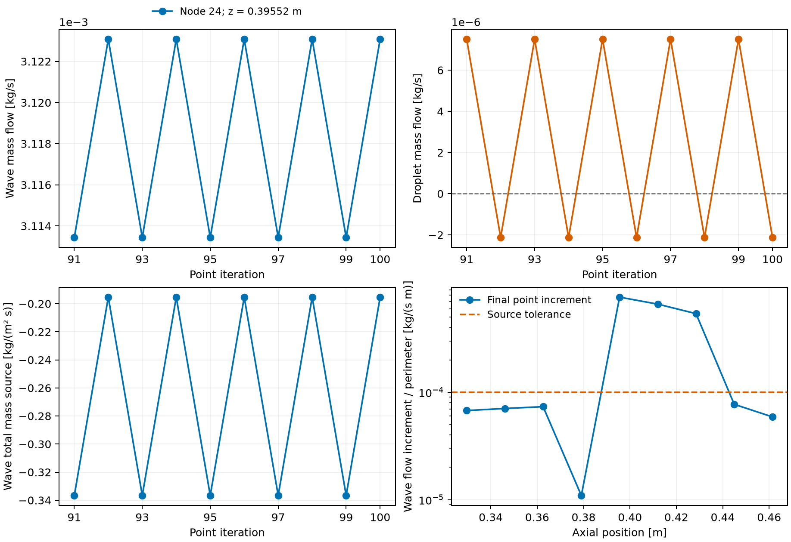

# Sawai entry 1: iteration oscillation diagnostic

Date: 2026-11-15. Case: FourField, Sawai entry 1, wave-frequency relaxation time 0.2 s, 100 cells. This study follows the confirmed precursor-selection correction in [the matched replay](MATCHED_DIAGNOSTIC_REPLAY.md). It changes no numerical implementation, governing equation, closure, input, tolerance, relaxation factor or iteration limit.

## Result and attribution

The native calculation still fails the original wave-flow point-convergence criterion at three nodes. Its late iterations alternate between two states. The detailed trace identifies **signed droplet deposition as the dominant varying contribution to the wave mass source**: it accounts for 98.87-99.75% of the source change between iterations 99 and 100 at those nodes. These percentages describe an observed source-term decomposition, not parity or experimental-validation scores.

No additional confirmed translation error was found in the reviewed active exchange, deposition, clipping and thin-base equilibrium paths. OpenSTREAM's original source contains the same signed deposition law and sequential updates. This is source-backed attribution of the mechanism observed in Python; it does **not** establish that a matched MATLAB execution reaches the same cycle. MATLAB execution remains unavailable, and no matching saved Sawai point trace has been recovered.

The result is an iteration oscillation during steady initialization, not a prediction of physical temporal oscillation in the experiment. The original failure and the corrected failed replay remain preserved. No default numerical setting has been changed to obtain convergence.

## Fixed case and evidence

| Setting | Retained value |
|---|---|
| Mesh | 100 cells, 101 nodes; dz=0.01648 m |
| Geometry | Length 1.648 m; area 1.2566e-5 m^2; wetted perimeter 0.012566 m; hydraulic diameter 0.004 m |
| Wave-frequency relaxation time | RELAXTW=0.2 s |
| Active closures | EPRI precursor; Okawa2003 entrainment; Okawa deposition; RISO base thickness; Sawai equilibrium Strouhal |
| Momentum | Base FULLNOP with source thin-film fallback; wave FULL; droplet SLIP |
| Point budget | MAXITER=100 |
| Wave mass-flow relaxation | RELAXWW=0.5 |
| Point wave-flow limit | Strictly below 1e-4 kg/(s m), an absolute iterate change per perimeter |
| Initialization endpoint | Pseudo-time 8 s; source STATE=INITIALSTEPCONVERGED; native converged=false |

The frozen manifest is `examples/sawai_oscillation_diagnostic.json`, based on Python commit `bf5083ce2db9c2ac5c1279b3d7858ca1dd39bf9e`. It binds all 25 native modules, the corrected reference files and the detailed trace window before execution. OpenSTREAM remains pinned to `a614c7173822a93c1e64ac28d1541cbac028cbd8`; database revision `b48541e6438a92b4c0ddc83cf0ceda3f71a59b22` supplies the case. The effective-input JSON contains all settings, rather than only the selected values above.

The observer records existing function returns and stored arrays without evaluating additional properties. The completed run reproduces **all 215 saved numerical arrays exactly**, including shape, dtype, values and NaN locations. Its coarse point, update and temporal traces are byte-identical to the preceding corrected replay. All 33 detailed point windows (nodes 24-26, iterations 90-100, pseudo-time 8 s) are present, containing 22,770 detailed records. Native sources, frozen inputs and original evidence remain unchanged.

Explicit Git line-ending rules preserve the already recorded native source bytes and observer files across new checkouts. This packaging change prevents automatic newline conversion from invalidating raw scientific hashes; it changes neither the current source bytes nor the normalized source blobs.

## The remaining failure

Node indices below are zero-based; MATLAB node numbers are one larger. The same fixed point tolerance applies to every row.

| Node | z (m) | Final wave-flow increment / perimeter, kg/(s m) | Increment / original tolerance |
|---:|---:|---:|---:|
| 24 | 0.39552 | 7.675963972e-4 | 7.67596 |
| 25 | 0.41200 | 6.609004634e-4 | 6.60900 |
| 26 | 0.42848 | 5.391071721e-4 | 5.39107 |

At node 24, wave mass flow alternates between 0.00311343786505 and 0.00312308348138 kg/s. The difference, 9.645616327e-6 kg/s, divided by the recorded perimeter gives the failed point increment. In the late window, returning after two iterations changes wave flow by at most 8.67e-19 kg/s across the three nodes. This supports a persistent two-cycle within the observed window; it is not a proof of global iteration stability or of behavior after an unlimited budget.

The source temporal stopping predicate is satisfied even though these point iterations exhaust their budget. OpenSTREAM logs point warnings and retains its temporal state; the Python port also reports the separate failed point-convergence flag. No additional phase-volume criterion is involved in this failure.

## What drives the alternating update

The source sequence is: update base mass flow; evaluate and update wave mass flow using the changed base; apply the existing positive-film operation; then recompute droplet flow as liquid precursor flow minus aggregate film flow. Thus deposition in the mass proposals uses the droplet flow left by the preceding point iteration.

At node 24 the wave source sees droplet flow -2.126825032e-6 kg/s during iteration 99 and +7.503307511e-6 kg/s during iteration 100. The corresponding actual Drop.MDEP returns are -0.04898078733 and +0.09198783574 kg/(m^2 s). Positive deposition adds film mass and reduces the recomputed droplet remainder; negative deposition reverses that transfer. The next iteration then uses the changed sign.

| Node | Change in total wave source, kg/(m^2 s) | Change in direct wave deposition, kg/(m^2 s) | Direct deposition share |
|---:|---:|---:|---:|
| 24 | 0.1413163801 | 0.1409666767 | 99.7525% |
| 25 | 0.1215435757 | 0.1209831045 | 99.5389% |
| 26 | 0.09904939531 | 0.09793403578 | 98.8739% |

These are iteration-100 minus iteration-99 differences evaluated at their actual coupled states. Evaporation, entrainment and internal base/wave transfer account for the remaining source change. The table is not an experiment with deposition disabled. All 66 recorded base/wave total-source sums reconstruct exactly from their recorded constituents.

Independently reconstructing the mass-update arithmetic gives 60/60 exact late-window proposals. At node 24, the unrelaxed wave proposal changes by 2.893684898e-5 kg/s. Holding the iteration-99 source coefficient for an algebraic decomposition attributes 2.886755268e-5 kg/s to the MTOT change; the velocity/coefficient and transport remainder is 6.929630175e-8 kg/s. Existing 0.5 relaxation then combines each proposal with the previous iterate. The source coefficient has units m^2, so multiplying a mass source in kg/(m^2 s) gives kg/s.

The [bounded source audit](sawai_oscillation_exchange_audit.md) maps these expressions to the original MATLAB files. Both implementations use absolute concentration plus the 1e-6 kg/m^3 offset, the same Okawa square-root expression, and a negative deposition sign when droplet flow is negative. At a common state, opposing internal turbulent transfers cancel algebraically; near the annular blend limit, most net deposition remains in the wave source. The actual sequential base and wave proposals use different states, so that identity does not prove discrete balance at an unconverged point.

The companion machine-readable analysis also records frozen-variable deposition derivatives. They are partial responses with properties, vapor flow, blending and other feedback held fixed; they are not eigenvalues of the complete iteration or a stability proof.

## Alternatives checked and limits

The late cycle does not switch between thin and thick base momentum branches. The checked final-pair base thicknesses are approximately 47.23-57.62 micrometres, below the unchanged 100 micrometre switch. The nested secant solves satisfy their original 0.001 Pa force tolerance; their final-pair trial residuals are approximately 1.83e-5 to 3.36e-4 Pa. That tolerance applies before the source's final velocity blend and is not a new force-balance claim for the blended state.

The positive-film operation changes wave flow by exactly zero in the late window; its base-flow changes are roundoff-sized. It is not an active zero clamp in this cycle. Retaining the signed droplet remainder is explicit source behavior. Clipping that remainder, suppressing negative deposition, smoothing the sign branch or replacing the sequential solve would change the retained algorithm and has not been done.

The audit is bounded to this finite, single-wall operating case and its active branches. It does not certify every closure option, precursor calculation, nonfinite path or floating-point ordering. Source agreement does not prove MATLAB runtime agreement. Neither this diagnosis nor native reproducibility establishes experimental validation. The 69-case publication campaign and its plotted comparison statistics remain historical pre-correction evidence; they have not been silently regenerated or reclassified.

## Acceptance consequence and next work

The acceptance matrix retains all 81 requirement IDs, their acceptance criteria and status axes. Sawai point convergence remains failed; broader MATLAB equivalence and experimental validation remain open. This study advances the attribution evidence rather than changing a pass/fail boundary. The earlier FourField precursor correction remains in place, with its separately established four-baseline regression evidence; those baselines were not rerun solely for this source-unchanged diagnostic.

Automated verification: the full collected Python suite passed 549 tests with the two retained FourField zero-slip warnings. After adding the checkout-byte guard, the final focused observer/provenance/constituent suite passed 20 tests; all 11 JavaScript tests also passed. The focused tests reject changed evidence, missing or reordered observations and invalid constituent sums, and check the signed-deposition derivative independently by finite differences. These software checks do not turn the retained scientific failure into a passing case. The replay also preserves the previous warning set, including point nonconvergence and the existing zero-slip warnings.

The next native investigation is a separately preregistered study of source-exposed mass-flow relaxation and iteration controls, retaining the same equations, closures, case and convergence tolerances. It must preserve the original attempt and distinguish a converged alternative numerical configuration from reproduction of the frozen configuration. A complete local iteration-map analysis can test the remaining coupled feedback. Matched MATLAB traces remain necessary to decide whether the identical frozen case cycles in that runtime. No additional closure model is proposed.

## Reproduction and retained files

Run from the project directory in PowerShell, choosing a new output directory:

```powershell
.\.venv\Scripts\python.exe tools\trace_sawai_oscillation.py --output outputs\verification\sawai-oscillation-repeat
.\.venv\Scripts\python.exe tools\audit_sawai_trace_provenance.py --trace outputs\verification\sawai-oscillation-repeat --output outputs\verification\sawai-oscillation-repeat-provenance.json
.\.venv\Scripts\python.exe tools\analyze_sawai_deposition_cycle.py --directory outputs\verification\sawai-oscillation-repeat --output outputs\verification\sawai-oscillation-repeat-analysis.json
```

The preregistered default window is intentionally limited; do not treat its 33 detailed points as coverage of every iteration. All selected-node stage/point histories are retained separately. The scripts reject existing output targets.

Evidence under `outputs/verification/sawai-oscillation-01/`:

- `deep-trace/assessment.json`: exact-array comparison, native source hashes and bound output hashes; effective inputs and runtime versions are retained in the associated numerical metadata.
- `deep_trace_provenance.json`: complete trace window, unchanged helpers, source hashes and byte-identical coarse histories.
- `saved_cycle_analysis.json`: independent proposal arithmetic, clipping, thin-base and cycle metrics.
- `deposition_cycle_analysis.json`: exact constituent sums, observed source attribution and explicitly limited partial derivatives.
- `acceptance_update_integrity.json`: unchanged requirements, criteria, statuses, 25 native modules and 45 historical files.
- `pytest.log` and `frontend.log`: executed automated verification results.



The first three panels show node 24 at initialization pseudo-time 8 s. The final panel shows the final wave-flow increment and the unchanged source tolerance at the selected axial nodes. The plotted droplet flow is the end-of-iteration value; deposition uses the preceding value as described above.
